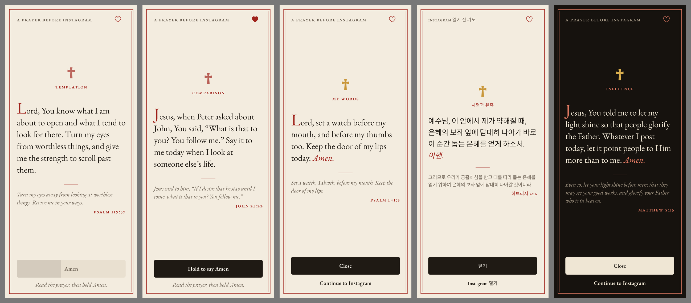
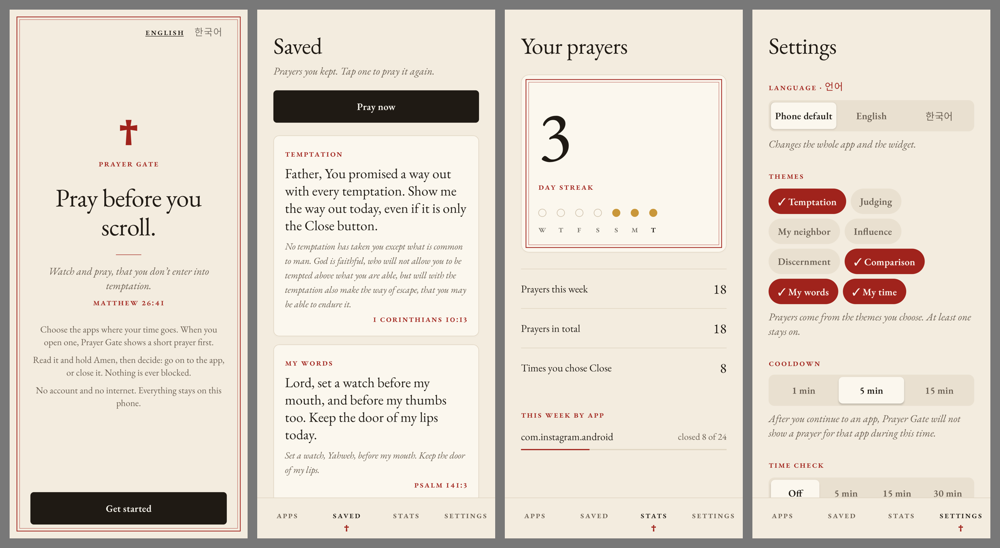

# Prayer Gate

An Android app for Christians who want to use social media well. Before a
chosen app opens, Prayer Gate shows one short prayer: about temptation,
judging others, loving your neighbor, your influence, discernment,
comparison, your words or your time. You read it, press and hold **Amen**,
then choose **Close** or **Continue**. Nothing is ever blocked.

No server, no account, no internet permission. Everything stays on the phone.
English and Korean.




## Build and install

```
./gradlew installDebug     # build and install on a phone with USB debugging on
./gradlew test             # unit tests and Robolectric touch tests (no phone needed)
```

Needs JDK 17+ and Android SDK platform 35. Runs on Android 8.0+. Debug builds
are signed with the committed `app/debug.keystore`, so a new APK installs as
an update over the old one and keeps the user's data.

## The pause

1. A chosen app comes to the front. One of two detection engines notices
   (A: usage access, polled every 300 ms; B: accessibility service).
2. `PrayerActivity` shows the next prayer from the chosen themes. Prayers are
   dealt like a shuffled deck: every prayer comes up once before any repeats.
3. The Amen button fills faintly while the prayer is read (a fifth of a second
   per word, at least 4 s), then turns white. Holding it for 1.5 s fills it
   with gold. TalkBack users double-tap instead.
4. Amen: "Amen." appears in red at the end of the prayer, the cross turns
   gold, a wash of gilt light rises, one haptic.
   Close (solid) and Continue (quiet) fade in where Amen was.
5. Continue starts a cooldown (1, 5 or 15 min). From the 3rd opening of the
   same app in an hour, Continue waits 5 s; from the 5th, 10 s. Close and the
   Back button always work at once.

Optional time check: after 5, 15 or 30 minutes in the app, another prayer.
Breaks under a minute don't reset the clock.

## Content

80 prayers, 10 per theme, written for this app in English and Korean
(Korean uses 하나님 and the reverent -소서 form). Each prayer takes up the
words of one Bible passage, and the passage itself is printed under the
prayer: World English Bible (public domain) and 개역한글 (1961, copyright term
ended). So "Set a watch before my mouth" sits above Psalm 141:3, "Set a watch,
Yahweh, before my mouth."

- `tools/make_prayers.py`: the prayers and their references. Run it to rebuild
  `app/src/main/assets/prayers.json`. It checks counts, duplicates, length,
  references, em dashes, and that every reference has its verse text, and it
  sets curly quotes. Never renumber existing prayers: saved prayers are keyed by id.
- `tools/fetch_verses.py`: downloads the verse text for every reference into
  `tools/verses.json` (needs internet; the app build does not). Run it after
  adding or changing a reference.

## Design

A printed prayer book: warm paper, black text, headings and references in
rubric red, and gilt for the moment you say Amen.

- **The page:** the prayer, the welcome screen and the streak card are framed by
  a double red rule. The prayer page reads top to bottom like a prayer book:
  the cross, the theme as a red rubric, the prayer with a large red initial,
  a short red rule, the verse in italic with its reference in red small
  capitals. After Amen a red "Amen." appears at the end of the prayer and the
  cross turns gold.
- **Colour roles:** paper and ink; rubric red for structure (headings,
  references, initials, the cross, selected options); gilt only as the reward.
- **Signature:** a Latin cross with flared ends (`crossPath()` in
  `ui/Components.kt`, shared with `tools/make_icons.py`). The app icon is a gilt
  cross on crimson, like a Bible cover.
- **Type:** EB Garamond throughout, with true small capitals for rubrics.
  Korean uses the phone's Korean font, upright.

Notes are at the top of `ui/theme/Theme.kt`.

## Text and Korean

The language follows the phone unless the user picks one: Settings > Language
(Phone default, English, 한국어) or the switch at the top of the welcome screen.
The choice is saved in the `settings` preferences (`AppLanguage`), applied to
both activities in `attachBaseContext`, and also used for the widget and the
Engine A notification, which the system would otherwise draw in the phone's
language. Reset keeps the language choice.

All UI text is in `res/values/strings.xml`. Korean is written in
`tools/strings_ko_source.xml` and generated with `python3 tools/make_strings_ko.py`,
which fails if any string is missing and glues Hangul syllables with U+2060 so
lines break between words.

## Project layout

```
app/src/main/java/com/prayergate/app/
  PrayerGateApp.kt          database, settings, background thread
  data/                     Room tables, settings, prayers, stats, reset
  detection/                both engines, GateController, SessionTimer, permissions
  ui/PrayerActivity.kt      the pause
  ui/                       onboarding, apps, saved, stats, settings, guide, legal, widget
tools/                      prayer, verse, Korean string and icon generators
docs/privacy-policy.md      hostable privacy policy (EN + KO)
```

## Before publishing

- Add a contact email to `legal_contact` in `strings.xml` and to `docs/privacy-policy.md`.
- Host the privacy policy and link it in the Play Console.
- Play declarations: accessibility API use (the in-app disclosure is in place),
  the `specialUse` foreground service, and "Display over other apps".
- Make a release signing key (keep it out of the repository).
